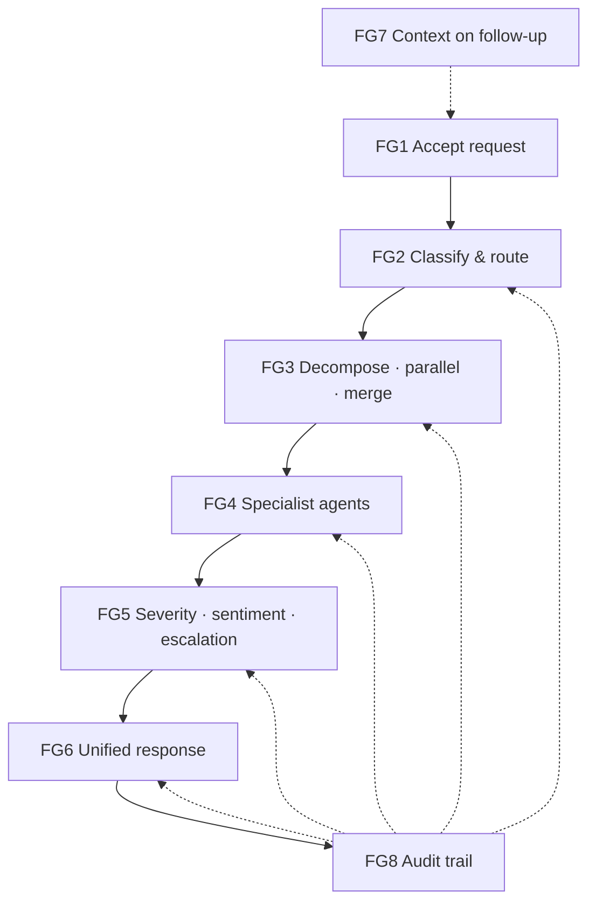

# Multi-Agent Customer Support Engine

**V1 — Functional Goals**

What the system must **do**. High level, in simple words.

> **Domain:** an online store (e-commerce). Five specialist agents cover the
> full post- and pre-purchase journey: **Technical, Billing, Policy, Orders,
> Products** (plus an Escalation agent for human handoff).

---

## FG1 — Accept support requests

- Take customer message as text input
- Optional ticket ID for follow-ups
- Reject empty input with a clear error

---

## FG2 — Classify intent and route correctly

- Detect intent: technical, billing, policy, orders, products, mixed, or unknown
- Show confidence per intent
- Use fallback when unsure — don’t silently guess wrong

---

## FG3 — Decompose and run agents in parallel

- Split mixed tickets into sub-problems
- Fan out to the right specialists in parallel
- Merge all agent findings into one result

---

## FG4 — Investigate with specialized agents

- **Technical** — login/account access, checkout & payment-page errors, site issues
- **Billing** — charges, failed/double payments, invoices, refunds
- **Policy** — return policy, cancellation rules, warranty, data/privacy
- **Orders** — order status, tracking, delivery, cancel/change an order
- **Products** — availability, stock, price, variants, specs (pre-purchase)
- **Escalation** — handoff when high-risk or unresolved

Each agent returns findings, actions, reasoning, and evidence.

---

## FG5 — Assess urgency and escalate when needed

- Assign severity and priority
- Detect customer sentiment (stretch)
- Trigger escalation for high-risk, conflict, or unresolved cases

---

## FG6 — Generate a unified customer-ready response

- One answer covering all sub-issues
- Include reasoning and evidence
- Professional tone, actionable next steps

---

## FG7 — Maintain context across follow-ups

- Same ticket ID retains prior investigation
- Follow-up messages build on earlier state

---

## FG8 — Log every step

- Structured audit trail for the full pipeline
- Every agent interaction recorded
- User can trace the final answer back to its source

---

## Flow mapping

---

## V1 must prove (demo)

| Scenario | Goals hit |
|----------|-----------|
| Billing-only ticket | FG2, FG4, FG6, FG8 |
| Mixed tech + billing ticket | FG2, FG3, FG4, FG6, FG8 |
| Ambiguous message | FG2 (fallback), FG8 |
| Frustrated customer | FG5, FG8 |
| Follow-up on same ticket | FG7 |
| Empty input | FG1 |

---