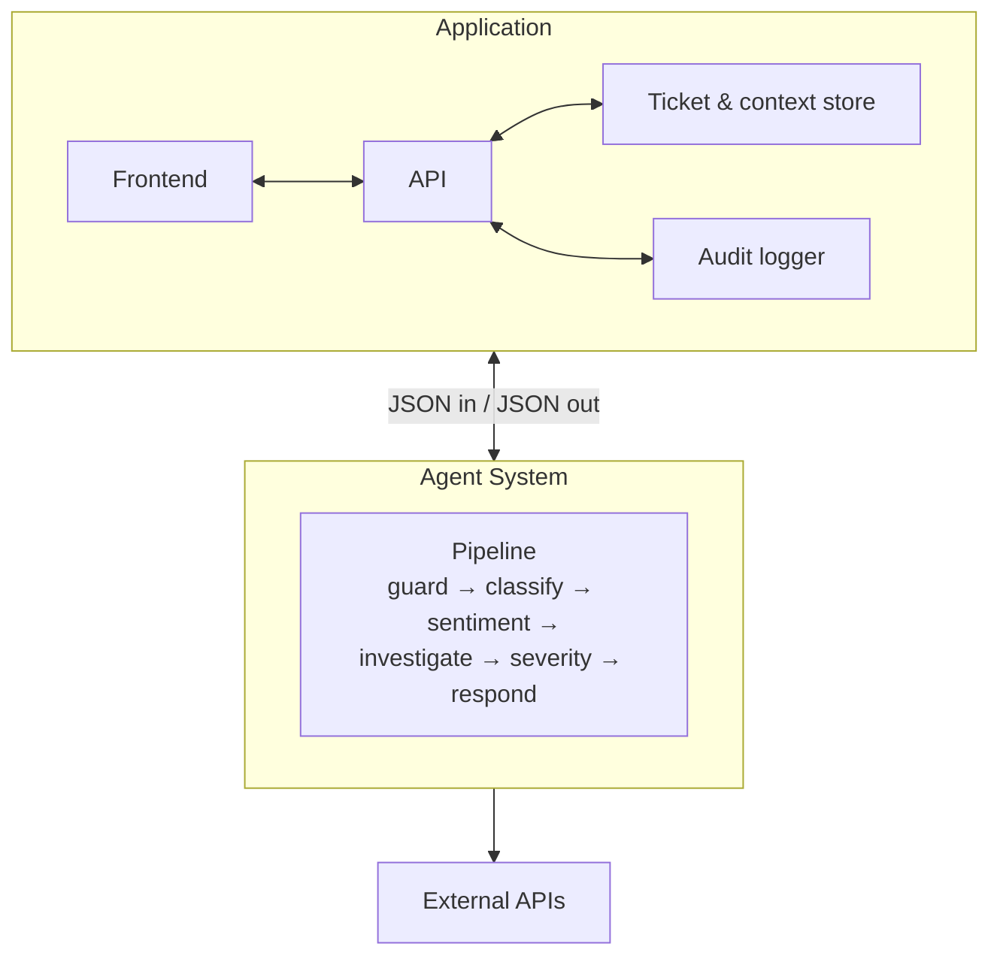
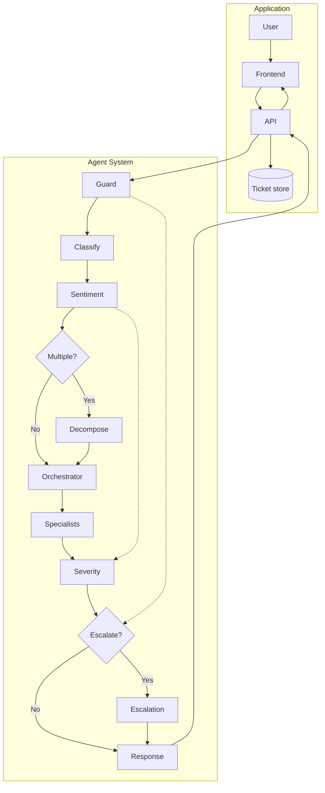
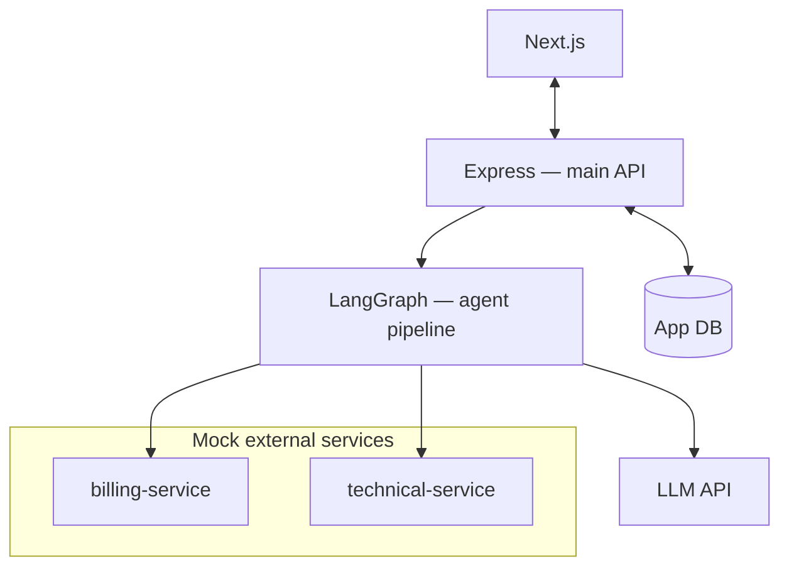
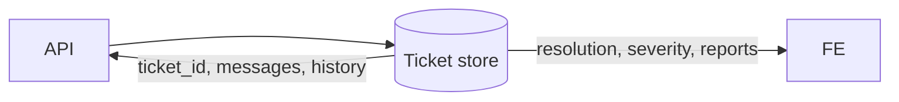

# Multi-Agent Customer Support Engine

**V1 — System Design**

Two main parts: **Application** and **Agent System**.  
JSON shapes below are the contracts — each step reads the pipeline object and adds its fields.

---

## System split



| Part | What it is |
|------|------------|
| **Application** | Frontend + API + storage + audit |
| **Agent System** | Full pipeline — each step adds fields to one JSON object |
| **External APIs** | LLM and outside services (agent system only) |

---

## Full pipeline



---

## Tech stack

| Layer | Choice | Role |
|-------|--------|------|
| **Frontend** | Next.js | UI — submit, flow, resolution, audit |
| **Application API** | Express.js | Tickets, storage, triggers pipeline |
| **Agent System** | LangGraph (TypeScript) | Full pipeline — guard through response |
| **App DB** | SQLite or PostgreSQL | Tickets, messages, outputs, audit |
| **Mock external APIs** | Express + DB each | Billing, technical — synthesized data |
| **LLM** | OpenAI / etc. | Called from LangGraph only |



**Rule:** Next.js → main API only. LangGraph → LLM + mock services. Frontend never calls mocks directly.

| Mock service | Used by | Purpose |
|--------------|---------|---------|
| billing-service | Billing agent | Invoices, charges, refunds |
| technical-service | Technical agent | Error codes, known issues |

Policy agent uses LLM + prompts only — no separate service.

---

## Repo structure

```text
support-engine/
├── apps/
│   ├── web/                 # Next.js — frontend
│   ├── api/                 # Express — application API + ticket store
│   └── agent/               # LangGraph (TS) — agent pipeline
│
└── services/                # Mock external APIs
    ├── billing-service/
    └── technical-service/
```

| Folder | Component |
|--------|-----------|
| `apps/web` | Frontend |
| `apps/api` | Application (API + storage + audit) |
| `apps/agent` | Agent System (LangGraph pipeline) |
| `services/billing-service` | Mock billing API |
| `services/technical-service` | Mock technical API |

---

## Main API flow

```
POST /api/tickets
  1. Validate message
  2. Load/create ticket in app DB
  3. Build pipeline entry JSON
  4. Run LangGraph pipeline → full JSON back
  5. Save result + audit
  6. Return to Next.js

GET /api/tickets/:id
  → ticket + last resolution + audit trail
```

---

## Interfaces (JSON at each step)

One object flows through the pipeline. Each step **adds fields** — nothing is thrown away.

```
Frontend request  →  API enriches  →  +guard  →  +classification  →  +sentiment
  →  +sub_problems  →  +agent_reports  →  +severity  →  +escalation  →  +resolution
  →  back to Frontend
```

---

### 0. Frontend → API

Sent on every submit.

```json
{
  "ticket_id": "T-001",
  "message": "App crashes after login and I was charged twice"
}
```

| Field | Required | Notes |
|-------|----------|-------|
| `message` | Yes | Customer text |
| `ticket_id` | No | Omit on first message; API creates one |

---

### 1. API → Agent System (pipeline entry)

API loads history from store, then starts the pipeline.

```json
{
  "ticket_id": "T-001",
  "run_id": "R-001",
  "message": "App crashes after login and I was charged twice",
  "message_count": 1,
  "history": []
}
```

| Field | Notes |
|-------|-------|
| `run_id` | New ID per pipeline run |
| `message_count` | Includes current message (used for repeat contact) |
| `history` | Prior customer messages, oldest first |

---

### 2. After Guard

```json
"guard": {
  "force_escalation": false,
  "reason": null,
  "matched_phrase": null
}
```

When a hard signal matches (human request, legal, chargeback):

```json
"guard": {
  "force_escalation": true,
  "reason": "Explicit human escalation request",
  "matched_phrase": "talk to a manager"
}
```

Used later at escalation gate — does not skip investigation.

---

### 3. After Classifier

```json
"classification": {
  "primary_intent": "mixed",
  "is_multi_issue": true,
  "fallback": false,
  "intents": [
    { "type": "technical", "confidence": 0.91 },
    { "type": "billing", "confidence": 0.89 }
  ]
}
```

`primary_intent`: `technical` | `billing` | `policy` | `mixed` | `unknown`  
`fallback: true` → safe route when confidence is low.

---

### 4. After Sentiment

```json
"sentiment": {
  "label": "frustrated",
  "score": 0.85
}
```

`label`: `neutral` | `frustrated` | `angry`

---

### 5. After Decompose (mixed tickets only)

```json
"sub_problems": [
  {
    "id": "SP-1",
    "domain": "technical",
    "description": "App crashes after login"
  },
  {
    "id": "SP-2",
    "domain": "billing",
    "description": "Charged twice this month"
  }
]
```

Single-issue tickets: one sub-problem (or derived from `primary_intent`).

---

### 6. After Specialist agents

```json
"agent_reports": [
  {
    "agent": "technical",
    "sub_problem_id": "SP-1",
    "findings": ["Known crash E-102 on login"],
    "actions": ["Clear cache", "Retry login"],
    "reasoning": "Matches documented issue E-102",
    "evidence": ["E-102"],
    "status": "resolved",
    "confidence": 0.88
  },
  {
    "agent": "billing",
    "sub_problem_id": "SP-2",
    "findings": ["Duplicate charge $29.99"],
    "actions": ["Issue refund $29.99"],
    "reasoning": "Two identical charges same day",
    "evidence": ["INV-123", "INV-124"],
    "status": "resolved",
    "confidence": 0.91
  }
],

"investigation": {
  "overall_status": "resolved",
  "conflicts": []
}
```

`status`: `resolved` | `needs_info` | `unresolved` | `failed`  
`overall_status`: `resolved` | `partial` | `unresolved`

---

### 7. After Severity & priority

```json
"severity": {
  "level": "medium",
  "priority": "P2",
  "reasoning": "Duplicate charge confirmed; customer on 2nd message"
}
```

`level`: `low` | `medium` | `high`  
`priority`: `P3` | `P2` | `P1`

Severity from agent findings. Priority from severity + sentiment + repeat contact.

---

### 8. After Escalation (if triggered)

```json
"escalation": {
  "escalate": true,
  "reason": "force_escalation from guard",
  "recommended_team": "Billing Lead",
  "urgency": "P1",
  "internal_actions": ["Manual invoice review"],
  "customer_addendum": "We've escalated to our billing specialist team."
}
```

If no escalation: `"escalation": { "escalate": false }`

---

### 9. Final — back to API / Frontend

```json
"resolution": {
  "summary": "We found two issues: login crash and duplicate charge.",
  "findings": [
    "Crash matches known issue E-102",
    "Duplicate $29.99 charge on Jan 15"
  ],
  "actions": [
    "Clear cache and retry login",
    "Refund $29.99 initiated"
  ],
  "reasoning": "E-102 has a documented fix; duplicate invoices warrant refund",
  "evidence": ["E-102", "INV-123", "INV-124"]
}
```

API saves full pipeline JSON + returns to frontend. UI shows `resolution`, `severity`, flow fields, and `audit_trail`.

---

## Who adds what

| Step | Person | Adds to JSON |
|------|--------|--------------|
| — | Application | Frontend request; enriches `history`; saves final output |
| 1 | Guard | `guard` |
| 2 | Classifier | `classification` |
| 3 | Sentiment | `sentiment` |
| 4 | Orchestrator | `sub_problems`, `agent_reports`, `investigation` |
| 5 | Specialists | Each item in `agent_reports[]` |
| 6 | Decide & respond | `severity`, `escalation`, `resolution` |

**Rule:** Each person builds their step against mock JSON with all prior fields filled in.

---

## Ticket storage (Application)



Stored per ticket: messages, full last pipeline output, audit events.

---

## One-line summary

**Next.js ↔ Express API ↔ LangGraph (TS) ↔ LLM + mock services. Frontend sends `{ ticket_id, message }` → pipeline JSON grows field by field → final JSON with `resolution` returns to UI.**
