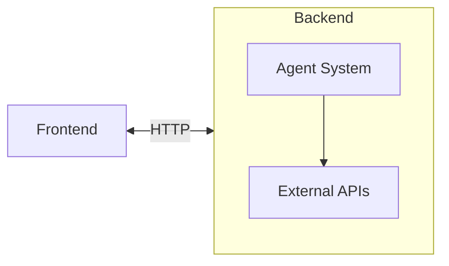
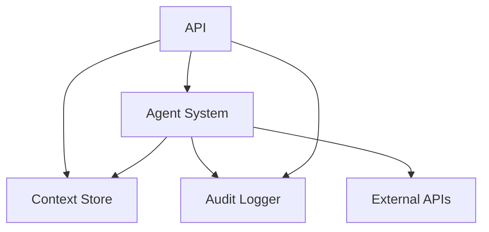
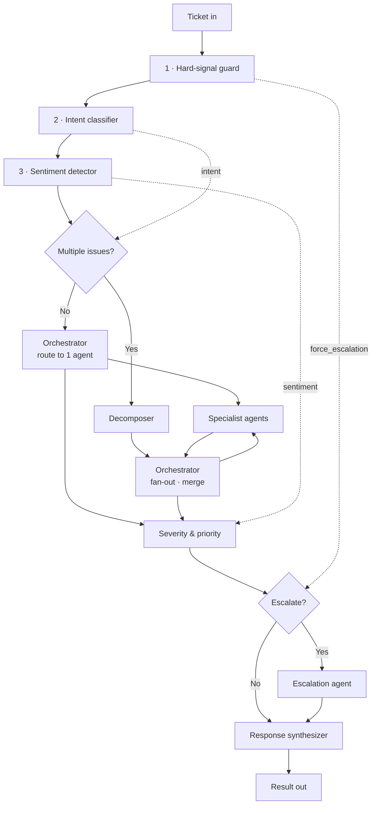

# Multi-Agent Customer Support Engine

**V1 — Technical Spec (High Level)**

Technical components derived from [functional-goals.md](./functional-goals.md). Simple and crisp.

---

## System layout

| Layer | Role |
|-------|------|
| **Frontend** | UI — submit, view flow, resolution, audit trail |
| **Backend** | Runs the pipeline, stores state, calls external services |
| **Agent System** | All agent logic — classify through respond |
| **External APIs** | LLM and any outside services the agent system needs |

---

## Backend — high-level components

---

## Agent System — pipeline

One unit in the backend. Owns the full pipeline.

### Early sequence (unpacked)

Runs in order at the start. Each output is used at a **different** later stage.

| # | Step | Produces | Used where |
|---|------|----------|------------|
| 1 | **Hard-signal guard** | `force_escalation` flag + reason | Escalation gate |
| 2 | **Intent classifier** | intent + confidence | Branch (single vs multiple) |
| 3 | **Sentiment detector** | tone (neutral / frustrated / angry) | Severity & priority (after agents) |

**Hard-signal guard** — explicit phrases only, not mood:
- Human request: "talk to a manager", "I want a human"
- Legal / compliance: "I'll sue", "data breach", "GDPR"
- Financial dispute: "chargeback", "disputing with my bank"

When matched → sets `force_escalation`. Agents **still run** to build context for handoff.

### Severity & priority

Assessed **once per message**, after agents investigate, before escalation.

| | Source |
|---|--------|
| **Severity** | Agent findings — impact, scope, workaround, money/data risk. **Not** customer wording. |
| **Priority** | Severity + modifiers — sentiment (capped nudge), repeat contact, time-sensitivity |

**Escalation triggers** (any one is enough):
- `force_escalation` from hard-signal guard
- High severity / impact from findings
- Unresolved — agent couldn't fix
- Conflict between agents
- Frustration **+** repeat contact or unresolved (frustration alone on a solvable issue → **no** escalation)

Re-run severity & priority on every follow-up message (repeat contact can change outcome).

---

## Component list

| Component | What it does |
|-----------|--------------|
| **Frontend** | React UI — intake, processing view, resolution, audit trail |
| **API** | REST endpoints — receive tickets, return results, validation |
| **Agent System** | Runs end-to-end pipeline (see internal parts below) |
| **Context Store** | Persists ticket state and conversation history |
| **Audit Logger** | Writes structured log events for every step |
| **External APIs** | LLM provider; optional mock data services |

### Inside Agent System

| Component | What it does |
|-----------|--------------|
| **Hard-signal guard** | Detects explicit escalation phrases; sets `force_escalation` flag |
| **Intent classifier** | Labels intent + confidence; triggers fallback |
| **Sentiment detector** | Customer tone / frustration (stretch) |
| **Decomposer** | Splits mixed tickets into sub-problems |
| **Orchestrator** | Routes work, runs agents in parallel, merges results |
| **Specialist agents** | Technical, Billing, Policy, Orders, Products — domain investigation (e-commerce) |
| **Severity assessor** | Severity and priority from findings + sentiment |
| **Escalation agent** | Handoff plan when escalation is needed |
| **Response synthesizer** | Builds unified customer-ready answer |

---

## Functional goals → components

| Goal | Component(s) |
|------|----------------|
| **FG1** Accept requests | Frontend, API |
| **FG2** Classify & route | Intent Classifier, Orchestrator |
| **FG3** Decompose · parallel · merge | Decomposer, Orchestrator |
| **FG4** Specialized investigation | Specialist Agents, Escalation Agent |
| **FG5** Urgency & escalation | Hard-signal guard, Severity assessor, Sentiment detector, Escalation agent |
| **FG6** Unified response | Response Synthesizer |
| **FG7** Context on follow-up | Context Store, API |
| **FG8** Log every step | Audit Logger (all components emit events) |

---

## Data that flows between components

| Artifact | Passed between |
|----------|----------------|
| **Ticket** | Frontend → API → Agent System |
| **force_escalation** | Hard-signal guard → Escalation gate |
| **Classification** | Classifier → Orchestrator |
| **Sentiment** | Sentiment detector → Severity assessor |
| **Sub-problems** | Decomposer → Orchestrator |
| **Agent report** | Agents → Orchestrator → Synthesizer |
| **Severity & priority** | Severity assessor → Escalation gate → Synthesizer |
| **Resolution** | Synthesizer → API → Frontend |
| **Audit event** | All → Audit Logger → Frontend |
| **Context** | Context Store ↔ API ↔ Agent System |

---

## One-line summary

**Frontend → API → Agent System (guard → classify → sentiment → investigate → severity → escalate → respond) → Context Store + Audit Logger + External APIs.**
