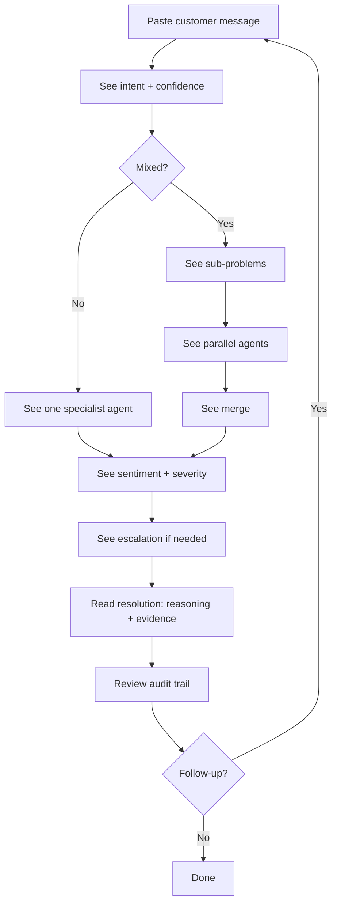

# Multi-Agent Customer Support Engine

**V1 — User Flow & Experience**

Simple description of what the user sees, does, and gets from the product.

---

## What can the user do?

| Capability | In simple words | Rubric it supports |
|------------|-----------------|-------------------|
| **Submit a ticket** | Paste or type a customer message and run the system | Demo |
| **See classification + confidence** | Intent label and how sure the system is | Classification **3** |
| **See fallback when unsure** | Low confidence → safe route (e.g. policy review), not a wild guess | Classification **3** |
| **Watch parallel investigation** | Mixed tickets split; agents run in parallel; results merged | Decomposition **3** |
| **See named specialists** | Technical, Billing, Policy, Orders, Products, Escalation — each visibly different | Agents **2** |
| **Read structured resolution** | Summary, actions, **reasoning**, **evidence** | Output **3** |
| **See customer sentiment** | Frustration / tone detected; may affect urgency | Stretch **2** |
| **Check structured audit trail** | Timeline of every step and which agent did what | Logs **2** |
| **Follow up on a ticket** | Same ticket ID keeps prior context | Output / flow |
| **Get clear errors** | Empty or bad input → message, no crash | Edge cases **2** |

---

## User flow (step by step)

### Step 1 — Submit

**User does:** Opens the app, pastes  message, clicks submit.  
Optional: same ticket ID/conversation  for a follow-up.

---

### Step 2 — Classification (must feel smart)

**User sees:**
- Intent: **technical** / **billing** / **policy** / **orders** / **products** / **mixed** / **unknown**
- **Confidence score** per intent (e.g. Billing 0.92)
- If **mixed** → message that ticket will be split
- If **low confidence** → **fallback** visible (e.g. “Routed to Policy for review” or “Needs manual review”) — never silent wrong routing

**User experience:** “I trust how it classified this — and I see when it’s unsure.”

---

### Step 3 — Investigation (parallel when needed)

**Single issue — user sees:**
- One **named** specialist (e.g. “Billing Agent investigating…”)

**Multiple issues — user sees:**
1. **Sub-problems** listed (e.g. “Crash after login” + “Duplicate charge”)
2. **Parallel** agents running (Technical + Billing at the same time — visible in flow)
3. **Merge** step — “Combining findings…”
4. Each agent is clearly **different** (not one generic bot)

**User experience:** “Real specialists worked on separate parts, then it came back together.”

---

### Step 4 — Sentiment, severity & escalation

**User sees:**
- **Sentiment** (stretch): neutral / frustrated / angry — shown on ticket or in flow
- **Severity & priority** (low / medium / high, P3–P1)
- **Escalation** if triggered — why, and what happens next
- Sentiment may **raise** severity (e.g. angry + billing issue → higher priority)

**User experience:** “I know how upset the customer is and how urgent this is.”

---

### Step 5 — Resolution (structured output)

**User sees one unified, customer-ready answer:**

| Section | What it contains |
|---------|------------------|
| **Summary** | What the customer reported |
| **Findings** | Per issue (if mixed) |
| **Actions** | What to do next |
| **Reasoning** | Why this resolution — required |
| **Evidence** | Invoice IDs, error codes, policy refs — traceable facts |

**User experience:** “I can send this to the customer and defend every line if asked.”

---

### Step 6 — Audit trail (structured)

**User sees a timeline** — not raw console logs:

| Event | Example |
|-------|---------|
| Ticket received | — |
| Intent classified | billing 0.94, technical 0.12 |
| Decomposed | SP-1 technical, SP-2 billing |
| Agent completed | Technical Agent — findings + reasoning |
| Agent completed | Billing Agent — findings + reasoning |
| Findings merged | — |
| Sentiment detected | frustrated |
| Severity assessed | medium / P2 |
| Escalation | yes/no + reason |
| Response synthesized | — |

**User experience:** “I can trace any sentence in the answer back to a step and an agent.”

---

## End-to-end flow (user view)

---

## Scenarios the user must experience (demo-aligned)

### 1. Billing-only (simple path)

> *"I was charged twice this month."*

- Classification: **Billing**, high confidence  
- **Billing Agent** only  
- Resolution with refund reasoning + evidence (e.g. invoice refs)  
- Audit trail end-to-end  

---

### 2. Mixed ticket — hero demo

> *"App crashes after login and I was charged twice."*

- Classification: **Mixed**, confidence per intent  
- Sub-problems shown  
- **Technical + Billing agents in parallel**  
- **Merge** visible  
- One answer covering **both** issues + reasoning + evidence  
- Audit shows both agents  

---

### 3. Low-confidence / ambiguous

> *"Something feels wrong with my account."*

- Low confidence visible  
- **Fallback** path shown (policy review / unknown — not forced billing or technical)  
- Logged in audit trail  

---

### 4. Frustrated customer (stretch)

> *"THIS IS THE THIRD TIME!!! Still charged twice!!!"*

- **Sentiment:** frustrated / angry  
- Severity may increase  
- Escalation more likely  
- Still full resolution + audit  

---

### 5. Follow-up (same ticket)

> *"Refund still not received."*

- Same ticket ID  
- Prior context used  
- Updated resolution — not starting from scratch  

---

### 6. Bad input (edge cases)

| Input | User sees |
|-------|-----------|
| Empty message | *"Please enter a message"* — no crash |
| Nonsense / very short | Graceful message or low-confidence path — no crash |
| System / API error | Clear error + can retry — no white screen |

---

## Screens (minimum)

| Section | User must see |
|---------|----------------|
| **Submit** | Message, ticket ID, submit |
| **Classification** | Intent, confidence, fallback if unsure |
| **Processing / flow** | Sub-problems, **parallel** agents, **merge**, named specialists |
| **Sentiment & severity** | Tone, priority, escalation flag |
| **Resolution** | Structured: summary, findings, actions, **reasoning**, **evidence** |
| **Audit trail** | Structured timeline — step, actor, summary |

Can be one page with sections or tabs — but all sections must be visible in demo without opening a terminal.

---

## One-line summary

**User pastes a problem → sees how it was classified (with confidence) → watches named specialists work in parallel when needed → reads one reasoned, evidence-backed answer → reviews a full audit trail → can follow up on the same ticket.**

That’s the v1 experience.
